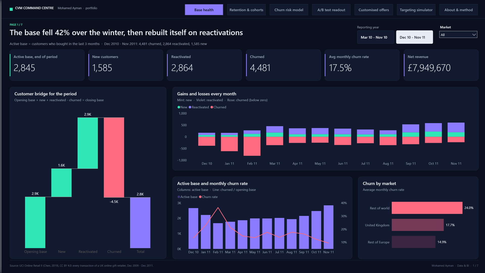
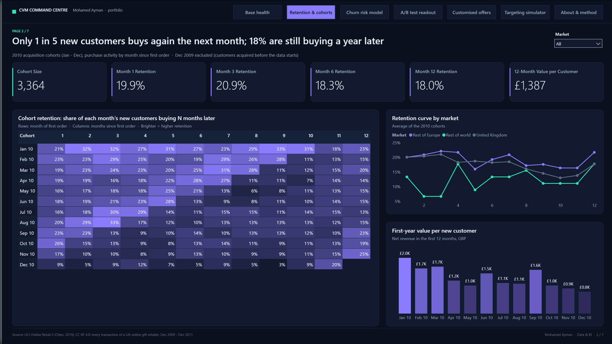
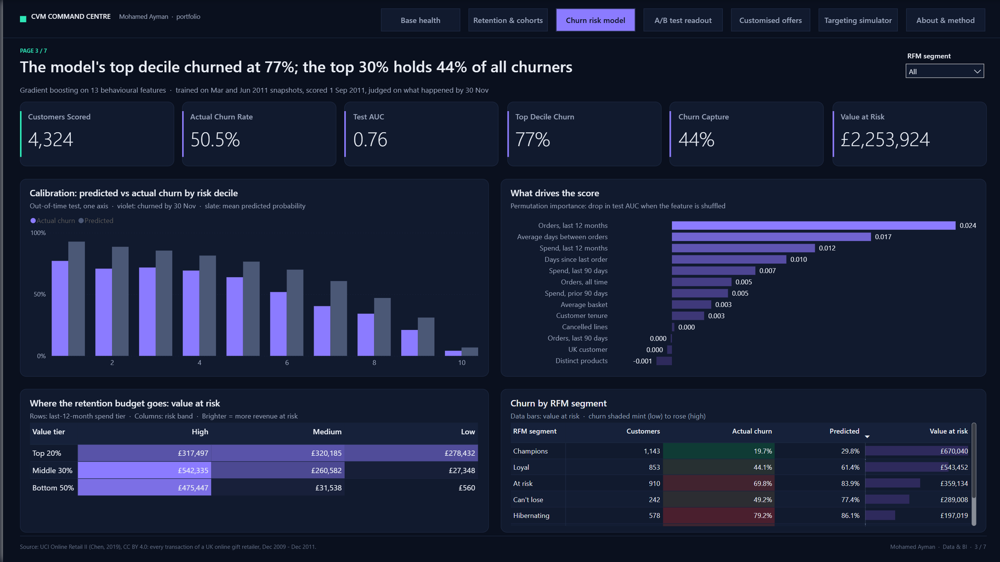
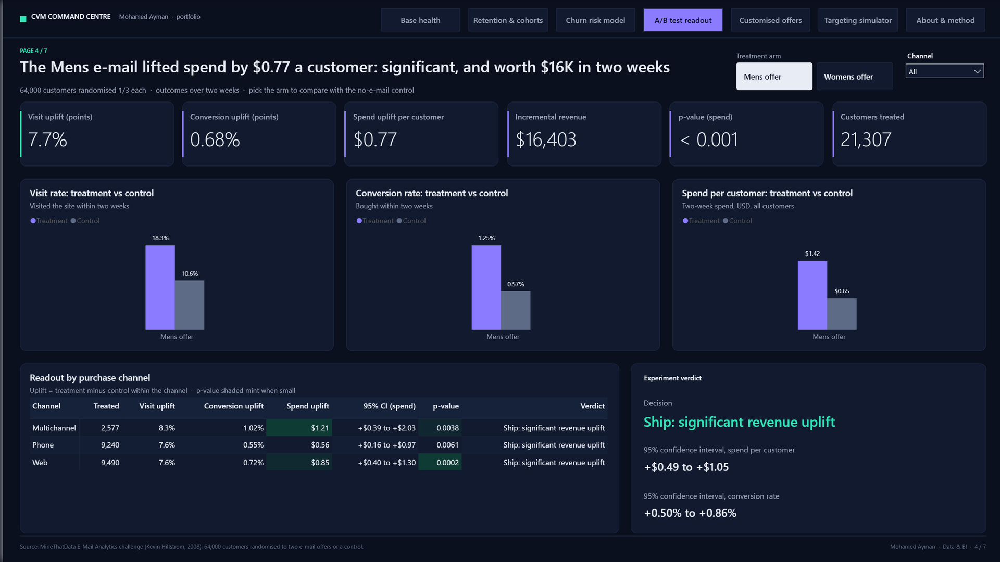
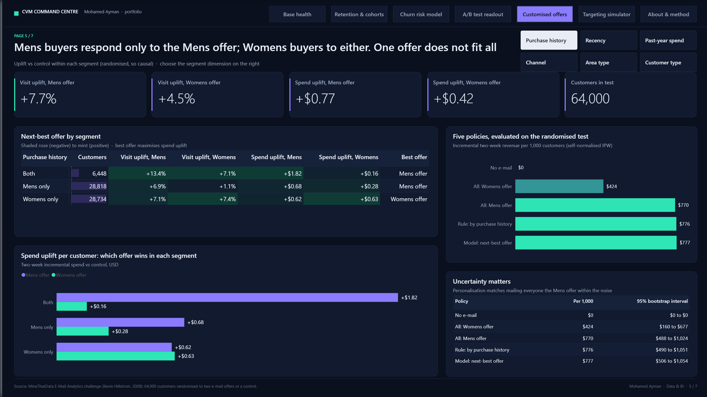
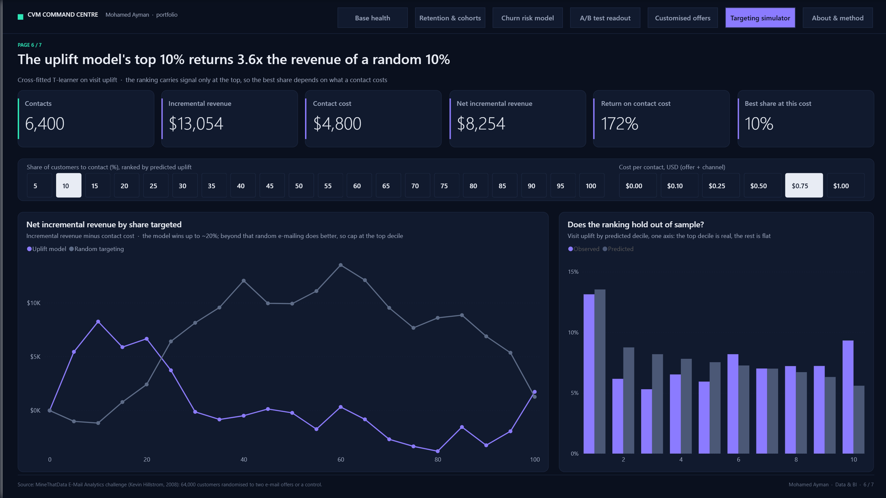
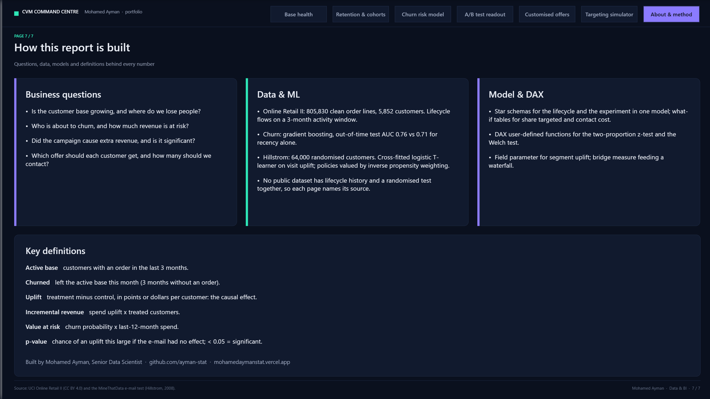

# CVM Command Centre: retention, churn and offer experiments

Customer value management end to end: base dynamics, cohorts, an out-of-time churn model, an A/B test readout, customised offers and an uplift-targeting simulator.

**Domain:** CVM / retention / experimentation  ·  **Built with:** Power BI Desktop (PBIP, PBIR, TMDL), DAX, Python  ·  **Author:** [Mohamed Ayman](https://mohamedaymanstat.vercel.app)



## What the data says

- The active base fell 42% over the winter, then rebuilt itself on reactivations (2,864 reactivated vs 1,585 new in Dec 2010 - Nov 2011).
- Only 1 in 5 new customers buys again the next month; 18% are still buying a year later.
- Churn model: out-of-time AUC 0.76 vs 0.71 for recency alone; the top decile churned at 77%.
- The Mens e-mail lifted two-week spend by $0.77 per customer (p < 0.001): about $16K across 21K treated customers.
- The uplift model's top 10% returns 3.6x the revenue of a random 10%, but a personalised next-best offer is no better than mailing everyone the Mens offer, within the noise. That is reported, not hidden.

## Pages

| Page | Preview |
|---|---|
| 1. Base health |  |
| 2. Retention & cohorts |  |
| 3. Churn risk model |  |
| 4. A/B test readout |  |
| 5. Customised offers |  |
| 6. Targeting simulator |  |
| 7. About & method |  |

## Model and DAX

- Customer bridge (opening + new + reactivated - churned = closing) as a waterfall, verified every month.
- DAX user-defined functions for a two-proportion z-test and a Welch test: p-values and confidence intervals live in the model.
- Field parameter for segment uplift; what-if tables for share targeted and contact cost.

## Machine learning

- Churn: gradient boosting on 13 behavioural features, trained on Mar and Jun 2011 snapshots, scored 1 Sep 2011, judged on the next 90 days.
- Uplift: cross-fitted logistic T-learner on visit uplift (spend is too sparse to rank individuals; tested and documented).
- Policies valued by self-normalised inverse-propensity weighting with bootstrap intervals: unbiased because arms were randomised.

## Data science

Three notebooks reproduce every model number in this report, then test it ([ds/README](ds/README.md), [model card](ds/model_card.md)):

- [01 EDA](ds/notebooks/01_eda_lifecycle_and_experiment.ipynb): cleaning with row counts, the seasonal churn base rate (42%-67%), label-window sensitivity and randomisation checks.
- [02 Churn model](ds/notebooks/02_churn_model.ipynb): out-of-time champion vs challenger. A regularised logistic (AUC 0.770) and a tuned LightGBM (0.773) beat the production model (0.761); a seasonal calibration fix; a retention budget ranked by margin at risk.
- [03 Uplift and policy](ds/notebooks/03_uplift_and_policy.ipynb): alternative uplift learners, uplift calibration, policy values with paired intervals, and the power analysis for the next test.

## Design

- Identity: **Command centre**: dark mode, violet for treatment, slate for control, mint for gains, pill-tab navigation, KPI tiles.
- Every page states its finding as the title, names its source in the footer and uses readable field names.
- Value-driven colour (gradients) on bars, conditional formatting in tables, numbers right-aligned under right-aligned headers.
- Each report in this portfolio has its own visual identity; see the other repos linked below.

## Data

- [UCI Online Retail II](https://archive.ics.uci.edu/dataset/502/online+retail+ii): Every transaction of a UK online gift retailer, Dec 2009 - Dec 2011 (805,830 clean order lines). Licence: CC BY 4.0.
- [MineThatData E-Mail Analytics challenge (Kevin Hillstrom, 2008)](https://blog.minethatdata.com/2008/03/minethatdata-e-mail-analytics-and-data.html): 64,000 customers randomised 1/3 each to a Mens e-mail, a Womens e-mail or no e-mail. Licence: Public research dataset.

The derived CSVs in `data/` are built by `etl/build_data.py` and keep the source licence above.

## How to run

1. Open `CVMExperiments.pbip` in Power BI Desktop (October 2026 or later; PBIR and DAX user-defined functions).
2. Refresh. The model reads `data/*.csv` straight from this GitHub repo (parameter `DataSource` = GitHub), so no setup or gateway is needed.
3. To rebuild everything from source:

```bash
pip install pandas numpy scikit-learn scipy openpyxl xlrd pyarrow
python etl/build_data.py      # source data -> data/*.csv (and models, where relevant)
python build/model.py         # writes the TMDL semantic model
python build/report.py        # writes the PBIR report
```

The report and model are generated from code (`build/`, using a shared design toolkit), so every visual, measure and page is reviewable in a diff.

## Limitations

- No public dataset has both lifecycle history and a randomised test, so the report uses two retailers; every page names its source.
- Two-week test outcomes; long-term effects of the e-mails are not observed.

## More in this portfolio

- [Olist Marketplace Performance](https://github.com/ayman-stat/powerbi-olist-marketplace): E-commerce / marketplace
- [Retail Bank Campaign Strategy](https://github.com/ayman-stat/powerbi-bank-campaign-strategy): Banking / direct marketing
- [Retail Network Performance](https://github.com/ayman-stat/powerbi-retail-network): Retail / store operations
- [Card Portfolio & Risk](https://github.com/ayman-stat/powerbi-card-portfolio-risk): Payments / cards / credit risk
- [Telecom Churn & Subscriber Value](https://github.com/ayman-stat/powerbi-telecom-churn-value): Telecom / CVM

---
Mohamed Ayman, Senior Data Scientist  ·  [Portfolio](https://mohamedaymanstat.vercel.app)  ·  [GitHub](https://github.com/ayman-stat)  ·  [LinkedIn](https://www.linkedin.com/in/mohamed-ghareb/)
