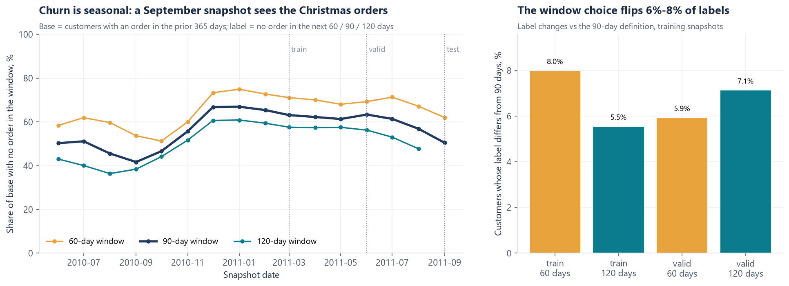
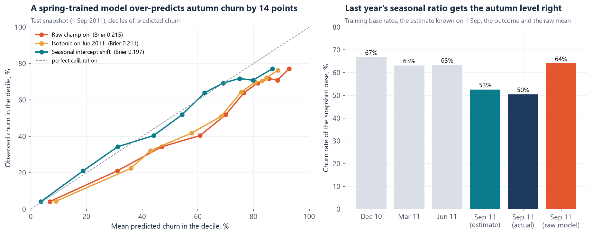
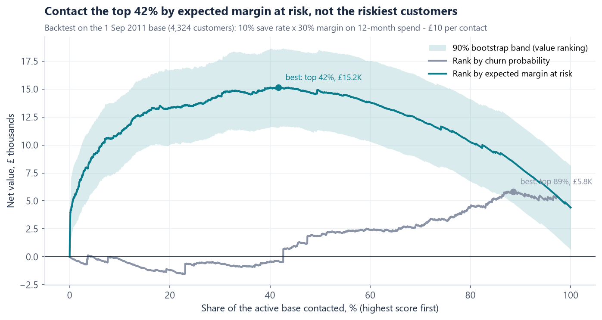
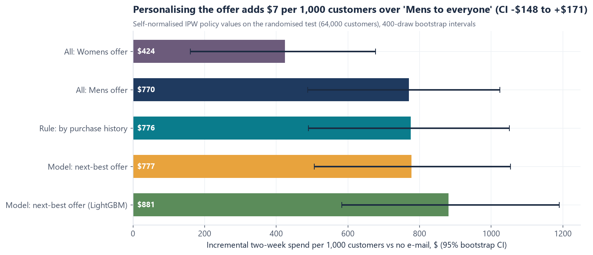

# Data science: churn, retention budget and offer policy

The Power BI report shows the answers; this folder shows how they were reached and how far to trust them. Three
notebooks follow CRISP-DM from the business question to a deployable decision. They reproduce every number the report
publishes before extending it.

## Lifecycle

| Stage | Notebook | Key output |
|---|---|---|
| Business understanding | [01 EDA](notebooks/01_eda_lifecycle_and_experiment.ipynb) §1 | Two decisions: who gets a retention contact, and which e-mail each customer gets |
| Data understanding | [01 EDA](notebooks/01_eda_lifecycle_and_experiment.ipynb) | Row counts at every cleaning step; churn base rate swings 42%-67% with the season; the e-mail test is a valid randomised experiment (SRM p = 0.90, max \|SMD\| 0.014) |
| Data preparation | [features.py](features.py), [02](notebooks/02_churn_model.ipynb) §1 | Snapshot features from data strictly before *t* (tested); out-of-time train / validate / test |
| Modelling | [02 churn model](notebooks/02_churn_model.ipynb) | Production model reproduced (AUC 0.7609); five candidates on identical out-of-time folds; tuned challenger |
| Evaluation | [02](notebooks/02_churn_model.ipynb), [03 uplift](notebooks/03_uplift_and_policy.ipynb) | Bootstrap CIs, paired tests, seasonal calibration fix, segment AUC, SHAP vs permutation, error analysis, uplift curves and decile calibration |
| Decision | [02](notebooks/02_churn_model.ipynb) §10, [03](notebooks/03_uplift_and_policy.ipynb) §5-9 | Retention budget curve with sensitivity; policy values with paired CIs; test design (power / MDE) |
| Deployment | [model_card.md](model_card.md) | Intended use, monitoring thresholds, retraining cadence, the hold-out that measures causal value |

## Results

| Question | Answer | Evidence |
|---|---|---|
| Does the production churn model reproduce? | Yes, exactly: test AUC 0.7609, validation 0.783, top-decile churn 77.1%, 43.5% of churners in the riskiest 30% | Asserted against `ml/metrics.json` |
| Is it the best model? | No. Tuned LightGBM 0.773 (+0.012, CI +0.007 to +0.017) and regularised logistic 0.770 (+0.009, CI +0.002 to +0.016) beat it; the champion ties a 25-cell RFM table | Paired bootstrap on the untouched Sep 2011 snapshot |
| Recommended churn model | Regularised logistic: as accurate as the tuned GBM (+0.003, CI -0.001 to +0.007) and transparent | Champion/challenger; the published numbers are unchanged |
| Are the probabilities right? | Not out of season: 64% predicted vs 50% observed. An intercept shift to last year's seasonal ratio fixes it (Brier 0.215 to 0.197) | Notebook 02 §6 |
| Who should get a retention contact? | The top 42% by expected margin at risk: £15.2K a quarter (90% band £11.6K-£18.5K) vs £5.8K ranking by churn risk, at a 10% save rate and £10 per contact | Backtest; sensitivity £3.7K-£102K over save rate |
| Should the e-mail be personalised? | No. Next-best offer adds $7 per 1,000 customers over Mens-to-everyone (CI -$148 to +$171) | IPW policy values on the randomised test |
| Where does targeting pay? | When contacts are limited: the uplift model's top 10% returns 3.6x the spend of a random 10% | Targeting simulator with bootstrap bands |

## Key figures

| | |
|---|---|
|  |  |
|  |  |

More: [lifecycle](figures/01-lifecycle.png), [A/B readout](figures/01-ab-readout.png), [design](figures/02-design.png),
[SHAP](figures/02-shap.png), [uplift curves](figures/03-uplift-curves.png), [heterogeneity](figures/03-heterogeneity.png).

## Reproduce

The notebooks read the raw files in `.raw/` (not committed; see the top of `etl/build_data.py` for the sources).
From the repo root, with the project's Python environment:

```bash
pip install pandas numpy scikit-learn scipy statsmodels lightgbm optuna shap matplotlib openpyxl jupytext nbconvert ipykernel
python etl/build_data.py                         # once: builds .raw/onlineretail/lines.pkl and data/*.csv
python -m jupytext --set-kernel python3 --to ipynb --execute ds/notebooks/01_eda_lifecycle_and_experiment.py
python -m jupytext --set-kernel python3 --to ipynb --execute ds/notebooks/02_churn_model.py
python -m jupytext --set-kernel python3 --to ipynb --execute ds/notebooks/03_uplift_and_policy.py
ruff check ds tests && pytest -q                 # lint + unit tests (synthetic data, no raw files needed)
```

Each notebook runs in about 1-4 minutes on a laptop (4 threads). The `.py` files are the reviewable source (jupytext
percent format); the `.ipynb` files are the executed versions that render on GitHub.

## Layout

```
ds/
  features.py      data loading, cleaning, snapshot features, uplift and policy estimators (imported by notebooks and tests)
  dskit/           shared helpers used across the portfolio (audit, EDA, evaluation, explainability, model selection)
  notebooks/       01 EDA, 02 churn model, 03 uplift and policy (.py source + executed .ipynb)
  figures/         the charts above
  reports/metrics.json   headline numbers written by the notebooks
  model_card.md
tests/test_features.py   no look-ahead, label window, cleaning rules, customer bridge, uplift and policy estimators
```
